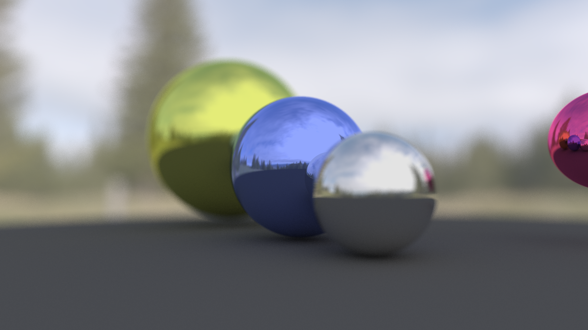
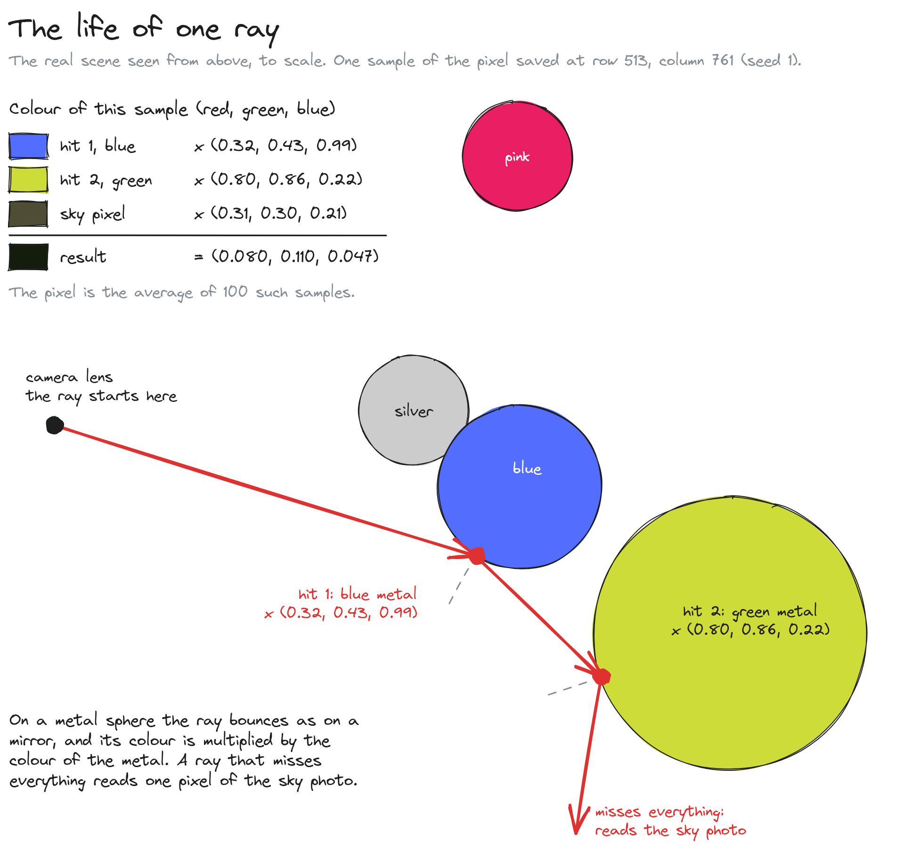
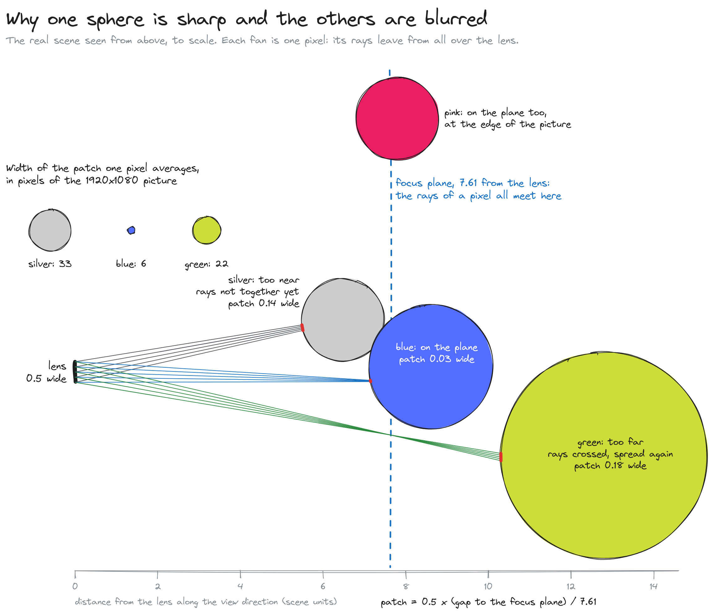
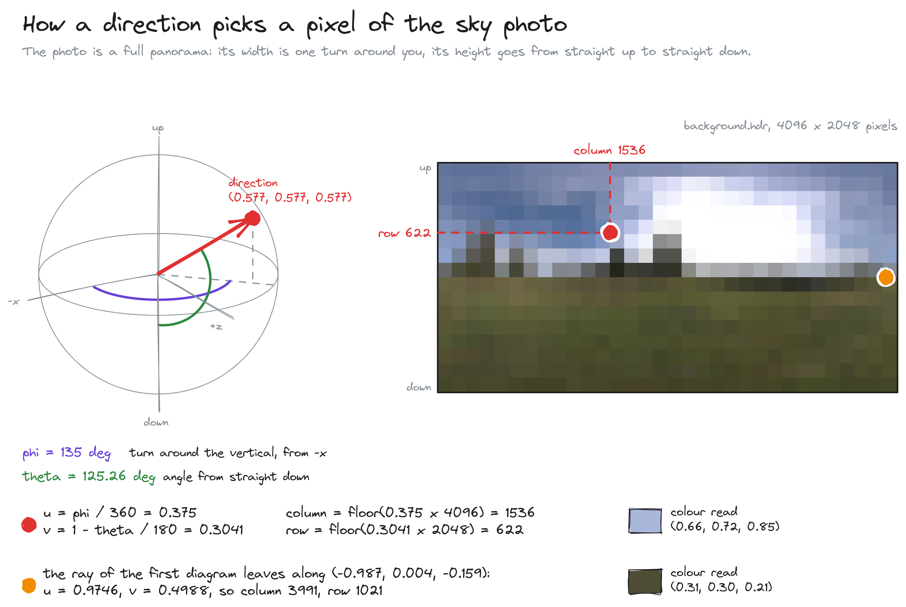
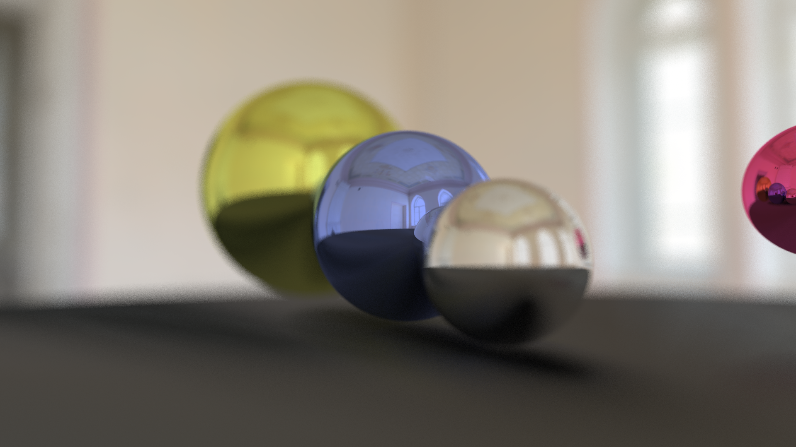
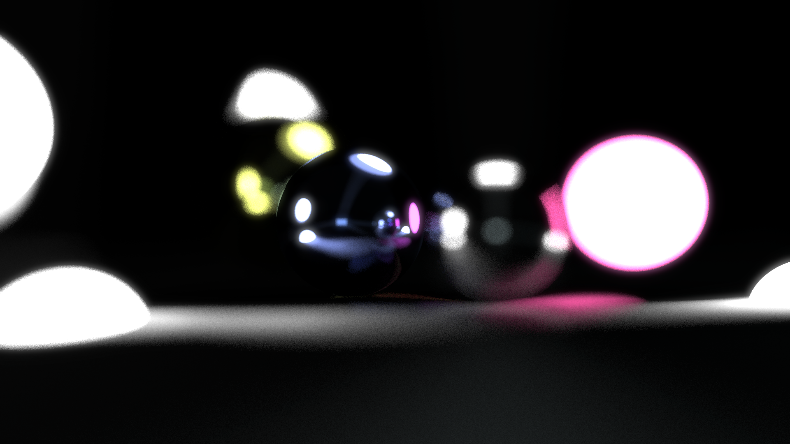

# EpicTracer


A path tracer I wrote from scratch in C++: it computes a photo-like picture of mirror spheres by following
207 million rays of light backwards from the camera, with no graphics library and no GPU.



*This picture is the program's own output: 1920×1080, 100 rays per pixel, 104 seconds on a 6-core Ryzen 5 5600.*

## At a glance

| | |
| --- | --- |
| **What** | A renderer that turns a description of spheres, materials and a camera into an image |
| **For** | Me, to learn how rendering works by building every step myself |
| **Stack** | C++17, OpenMP, CMake, doctest, `stb_image` for reading the sky photo |
| **Result** | Under 900 lines of C++, 31 unit tests, and the picture above in 104 s |

## What the project is

A photograph records the light that reaches a camera. A path tracer computes the same thing in reverse:
for every pixel it sends a ray out of the camera, finds the first object the ray hits, asks the object's
material where the light would have come from, and follows that direction in turn. The path ends when it
leaves the scene and reaches the sky, or when it has bounced 20 times. The colour of the pixel is the
colour of the sky at the end of the path, tinted by every surface met on the way.

One path gives one noisy guess, so I average 100 paths per pixel, each through a slightly different point
of the pixel. At 1920×1080 that is 207,360,000 paths for one picture.

The scene is small on purpose: four metal spheres and a matte floor, lit only by a 360° photograph of a
real sky. Everything you see in the picture (the reflections of spheres inside spheres, the soft shadow
under them, the blurred trees) comes out of that one loop. Nothing is drawn by hand.

## Words used in this README

- **Ray**: a half-line with a start point and a direction; the path a beam of light follows.
- **Sample**: one ray sent through a pixel. More samples per pixel give less noise.
- **Bounce**: what happens when a ray hits a surface and leaves in a new direction.
- **Normal**: the direction that points straight out of a surface at a given point.
- **Diffuse (Lambertian) surface**: a matte surface that sends light back in random directions.
- **Albedo**: the share of light a surface reflects, for each of red, green and blue.
- **Antialiasing**: averaging several samples per pixel so that edges are smooth and not jagged.
- **Depth of field**: the range of distances that look sharp; outside it, objects are blurred.
- **Aperture**: the diameter of the lens opening. A wider aperture gives a stronger blur.
- **Environment map**: a 360° photograph wrapped around the scene and used as the sky and the light.
- **OpenMP**: a C++ compiler feature that splits a loop between the processor's cores.

## What it does

- **Three materials**: mirror-like metal with a colour tint, matte diffuse, and light-emitting.
- **Reflections of reflections**: a path can bounce up to 20 times, so each sphere shows the others.
- **Depth of field**: a simulated lens keeps one distance sharp and blurs the rest, like a real camera.
- **Smooth edges**: every pixel averages 100 randomly placed samples.
- **Lighting from a photograph**: a 4096×2048 sky image is both the background and the only light.
- **All cores**: the rows of the image are shared between threads with OpenMP.

## How it works

### One ray, start to finish



The whole renderer is this loop, in [`rayTrace`](src/main.cpp):

1. The camera builds a ray for the pixel ([`Camera::getRay`](src/Camera.cpp)).
2. Every sphere is tested, and the nearest hit wins ([`Sphere::hit`](src/Sphere.h)).
3. The material of that sphere picks the next direction and a colour multiplier ([`Material.h`](src/Material.h)).
4. Steps 2 and 3 repeat from the hit point. A ray that hits nothing reads the sky photo.

Step 2 is the part I like most, because it is school algebra doing real work. A point on a ray is
`origin + t × direction`. Put that into the equation of a sphere and you get a quadratic in `t`. Take a ray
that starts at `(0, 0, -5)` and points along `+z`, and a sphere of radius 1 at the origin: the two
solutions are `t = 4` and `t = 6`, the points where the ray enters and leaves. The renderer keeps the
smaller one, `(0, 0, -1)`. That exact case is the first test in [`tests/test_sphere.cpp`](tests/test_sphere.cpp).

A mirror then needs one line: the reflected direction is `d − 2(d·n)n`. A ray going down at 45°,
`(1, -1, 0)`, that hits a floor whose normal is `(0, 1, 0)` leaves as `(1, 1, 0)`.

The diagram follows one real sample. It hits the blue sphere, then the green one, then leaves towards a
dark patch of the sky photo, `(0.31, 0.30, 0.21)`. Each metal multiplies the colour by its own tint, so the
sample ends as `(0.080, 0.110, 0.047)`: what is left of that patch of sky after a blue and a green mirror.

### Why one sphere is sharp and the others are not



A pinhole camera sends every ray of a pixel from the same point, so everything is sharp. I wanted the
look of a real lens, so each ray starts from a random point of a disk 0.5 units wide and aims at the same
point of the *focus plane*, 7.61 units away. Rays that hit something on that plane agree, and the pixel is
sharp. Rays that hit something nearer or farther land in different places, and their average is a blur.
In this scene the front of the blue sphere is closest to the plane, so one of its pixels averages a patch
about 6 pixels wide. On the silver sphere, which is too near, the patch is 33 pixels wide, and on the
green one, which is too far, 22.
The alternative, a pinhole, is simpler and less noisy, and I kept it reachable: an aperture of 0 in `main.cpp`
gives it back.

### How a direction becomes a pixel of the sky



The sky photo is a rectangle, like a world map. A ray that leaves the scene has a direction; its compass
angle picks the column and its height above the horizon picks the row
([`Image::sample`](src/Image.cpp)). Straight up is the top row, straight down the bottom row.

## Quick start

You need a C++17 compiler (GCC or Clang), CMake 3.16 or newer, and optionally ImageMagick to convert the
result to PNG.

```bash
git clone https://github.com/mbenimam/EpicTracer.git
cd EpicTracer
cmake -B build
cmake --build build -j
./build/epictracer --width 480 --height 270 --spp 20     # a preview, about 2 seconds
magick render.ppm render.png
```

Run it from the repository root, because the sky image is read from `assets/background.hdr`.
Without options it renders the full 1920×1080 picture at 100 samples per pixel.

| Option | Default | Meaning |
| --- | --- | --- |
| `--width`, `--height` | 1920, 1080 | Size of the image in pixels |
| `--spp` | 100 | Samples per pixel; more is cleaner and slower |
| `--depth` | 20 | Maximum number of bounces per path |
| `--sky` | `assets/background.hdr` | Environment map, any format `stb_image` reads |
| `--out` | `render.ppm` | Output file, in plain PPM format |

## Tests

```bash
ctest --test-dir build --output-on-failure
```

This runs 31 unit tests and one small end-to-end render. The tests check the vector maths, the two roots
of the ray–sphere equation, the mirror and diffuse materials, the lens, and the sky lookup. To check that
they are worth having, I put 13 bugs back into a copy of the code, one at a time (a wrong root, a missing
square, a lens twice too wide, and so on): each one made at least one test fail.

## Project layout

```text
src/           the renderer: camera, sphere, materials, image, and the main loop
tests/         unit tests (doctest)
assets/        the sky photograph
third_party/   stb_image and doctest, both single-header libraries
docs/assets/   renders and diagrams used in this README
```

## Gallery

Earlier renders, made in 2021 with scenes that are no longer in the code:

| A room photograph as the sky | Spheres that emit light |
| --- | --- |
|  |  |

## Status

It renders spheres, and only spheres. The scene and the camera are written in `main.cpp`, so changing
them means recompiling.

The speed is the honest weak point. Six threads are only 2.0 times faster than one: a 640×360 render
at 32 samples takes 7.8 s on one thread and 3.9 s on six (median of three runs each, on a machine that
was not idle). Every vector operation allocates memory, about 37 allocations per sample, and the rows are
split evenly between threads although some rows cost twice as much as others.

Next on my list: store vectors by value and measure the gain, then a scene file, then triangles.
